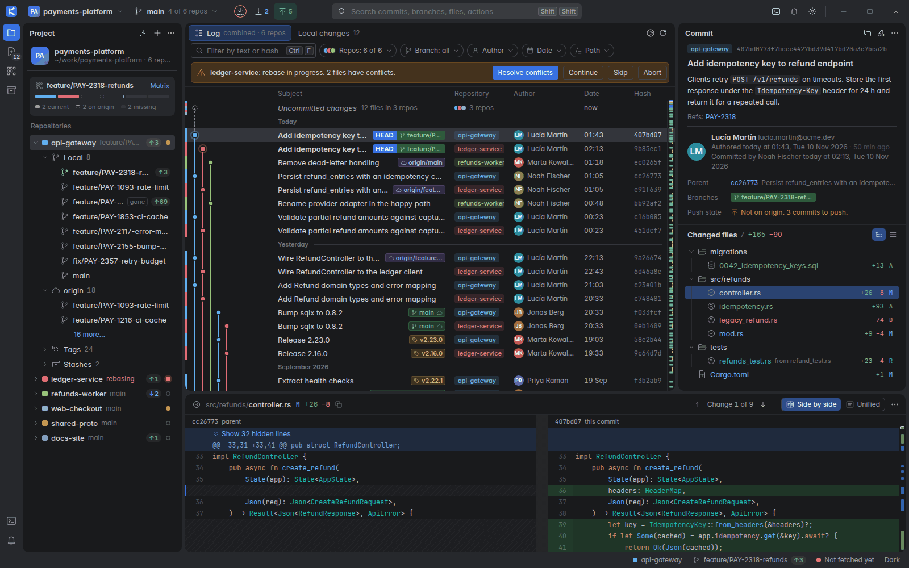

# DeepGit

DeepGit is a desktop Git client for projects that contain many repositories.
It shows the commits of all repositories in one graph and lets you run one branch operation on many repositories at the same time.
The window follows the JetBrains New UI "Islands" style.
The backend is written in Rust and runs the `git` command-line program. The interface uses SolidJS in a Tauri 2 window.



## Features

### Multi-repo projects

- Add one folder. DeepGit finds every Git repository inside it, up to four levels deep, including nested repositories.
- A project with one repository works the same way. It is a project with a list of one.
- Repositories are told apart by name. Colour is kept for state: added, modified, deleted, ahead, behind, errors.
- Show or hide single repositories in the log.

### Commit log and graph

- One merged log for all repositories of the project, with a graph coloured by lane.
- A repository column shows which repository owns each commit.
- Filters for text, hash, repository, branch, author, date and path.
- Branch and tag labels on the commits ("ref pills"), date groups and an "Uncommitted changes" row.
- Overview ruler: a map of the whole history that shows HEAD, branch tips, tags and the selected commit.
- The log loads only the visible rows, so large histories stay fast.

### Details and diff

- Commit details: message, people, parents, branches, tags, push state and a tree or list of changed files.
- Diff viewer with side-by-side and unified layout, word highlighting, syntax colours and ignore-whitespace options.
- Jump from change to change with `F7` and `Shift+F7`.
- Stage, unstage and discard single hunks.

### Local changes and commit

- Staged, unstaged and conflicted files, grouped by repository.
- Conflicts dialog (Accept Yours / Theirs, Merge…) and a three-pane merge window: Yours, Result, Theirs. It can apply the changes that do not collide, merge a conflict word by word, and it handles delete/modify, binary files and the swap of sides in a rebase.
- Commit, amend, and commit and push.
- One commit message can go to several repositories at once.
- The commit message draft is kept for each project.

### Branch operations and dialogs

- Checkout, new branch, rename, delete, merge, rebase, cherry-pick, revert, reset, tag, stash, fetch, pull and push.
- The Git console lists every `git` command that DeepGit ran.
- The menus name the branches they act on, for example "Merge feature/x into main".

### Branch matrix and synchronous branch control

- The branch matrix is a grid of repositories and branches. Each cell shows if the branch is checked out, local, only on `origin`, or missing.
- Select a branch column and run one operation on all repositories: checkout, create, pull, push, merge or delete.
- Repositories where the operation does not apply are skipped. They do not fail.
- The title-bar branch popup gives the same control in a smaller space.

### Search Everywhere

- Press `Shift` twice or `Ctrl+K` to search commits, branches, changed files, repositories and actions.
- Use the prefixes `#`, `@`, `/`, `>` and `:` to limit the search.

### Git console and command ticker

- The Git console lists every command that DeepGit runs, with output, exit code and duration.
- The status bar shows the last command that you started. Click it to open the console.
- DeepGit hides credentials in URLs that appear in the console.

### Safety

- Every destructive write asks first: discard, hard reset, branch and tag delete, stash drop, abort of a merge or rebase.
- Other writes can be undone with Git, for example with the reflog.
- When `git` or `ssh` needs a password, a token, a key passphrase or a host-key decision, DeepGit shows a dialog. It can save the secret in the system key store (Secret Service, Keychain or Credential Manager). An SSH agent or a Git credential helper still works and is tried first.
- DeepGit makes no network calls of its own. Only `git` talks to the network, when you fetch, pull or push.

## Requirements

- Rust 1.99 or newer. `rustup` installs it. The file `rust-toolchain.toml` adds `rustfmt` and `clippy`.
- Node.js 20 or newer, with npm.
- Git 2.24 or newer in the `PATH`.
- Linux only: the WebKitGTK 4.1 and GTK 3 development packages (`webkit2gtk-4.1`). See the [Tauri prerequisites](https://v2.tauri.app/start/prerequisites/).

## Run, build and test

Run `make help` to see all targets.

```bash
make install     # install the frontend dependencies (npm ci)
npm run dev      # frontend only, in a browser (http://localhost:1420), with fictional demo data
make dev         # desktop app with hot reload (Vite + Tauri)
make run         # fast-release desktop build, then start it
make build       # optimized release binary: target/release/deepgit
make bundle      # installer bundles for your operating system
make test        # frontend tests (vitest) and Rust tests (cargo test)
make lint        # tsc, clippy (warnings are errors) and rustfmt check
make check       # lint and tests
make ci          # lint, tests and frontend build
make fmt         # format the Rust code
make clean       # remove target/ and dist/
```

`npm run dev` uses a built-in fake backend. It shows an example project with six repositories and thousands of invented commits. It does not touch your files.

## Icons

The app icon is a generated tree of commits (spec: `docs/design/ITERATION-3.md`, section 13). Do not edit these files by hand: `src-tauri/icons/*.svg`, `public/favicon.svg` and `src/features/welcome/logoData.ts`. Change the parameters in `scripts/gen-logo.mjs`, then regenerate everything:

```bash
bash scripts/gen-icons.sh   # SVGs, Welcome logo data, then every PNG, icon.icns and icon.ico in src-tauri/icons
```

The script needs `npm install` (it runs `npx tauri icon`), and Python 3 with Pillow for `scripts/pack-ico.py` (`pip install pillow`). The large variant (6 levels) is used from 64 px up, and the small variant (4 levels) for the sizes under 64 px and for the favicon. `icon.icns` can change byte order between runs while its images stay the same.

## Project layout

```
crates/gitcore/   Rust Git library (no Tauri dependency): runner, log, graph, refs, status, diff, operations
src-tauri/        Tauri app: commands, workspace file, file watcher, log sessions
src/              SolidJS interface
  api/            typed wrappers for the Tauri commands, and the browser mock
  components/ui/  shared interface parts (menus, dialogs, tree, virtual list)
  features/       one folder for each part of the window (log, diff, changes, matrix, ...)
  state/          stores, keyboard registry and git actions
docs/             documentation and design files
```

## Documentation

- [User guide](docs/USER-GUIDE.md): how to use DeepGit, all keyboard shortcuts and troubleshooting.
- [Architecture contract](docs/PLAN.md): types, commands and events between the Rust backend and the interface.
- [Design specification](docs/design/DESIGN.md): layout, colours, components and keyboard map.

## Licence

MIT. See [LICENSE](LICENSE).
The bundled fonts (Inter and JetBrains Mono) and the note about the icons are in [NOTICE](NOTICE).
