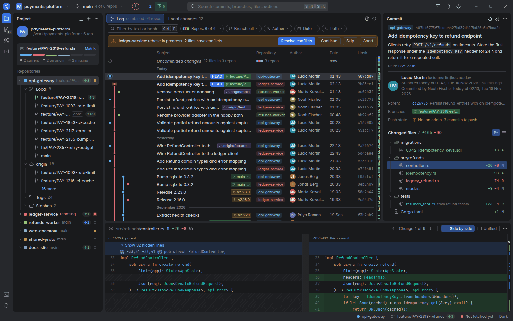
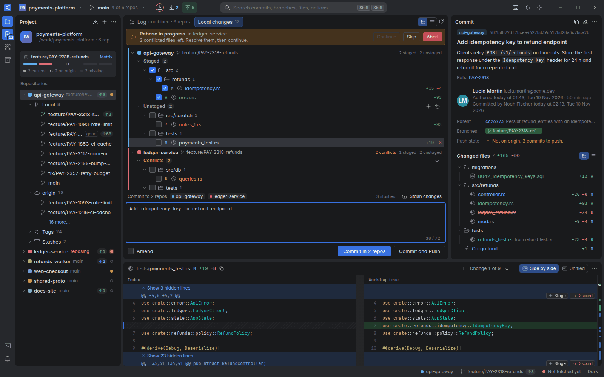
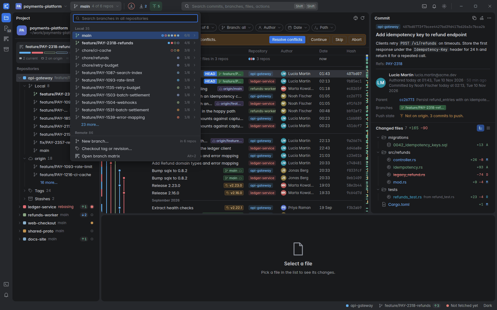
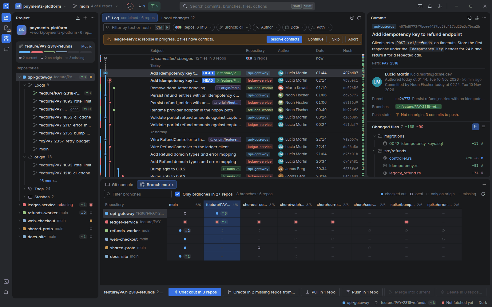
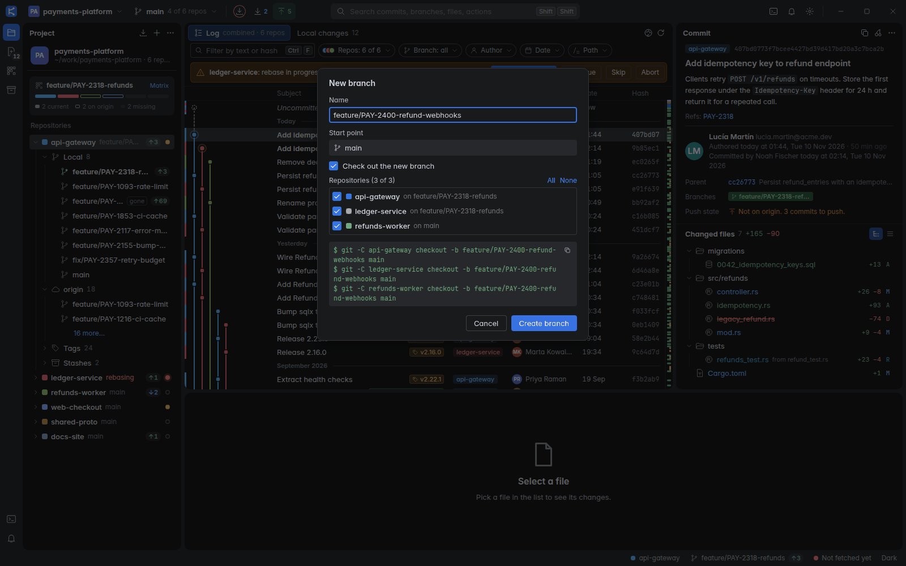
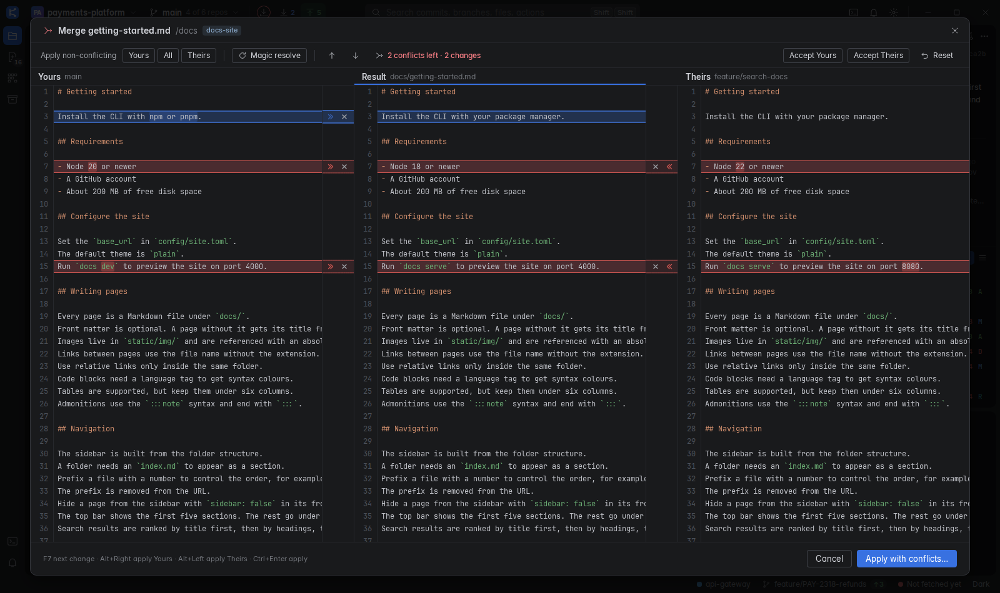
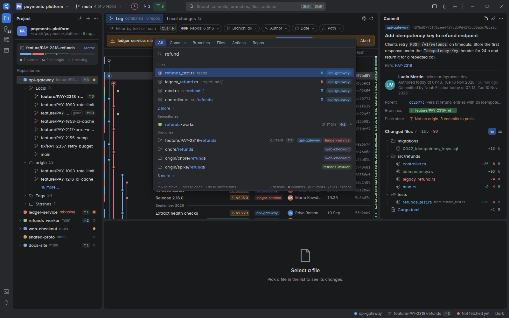
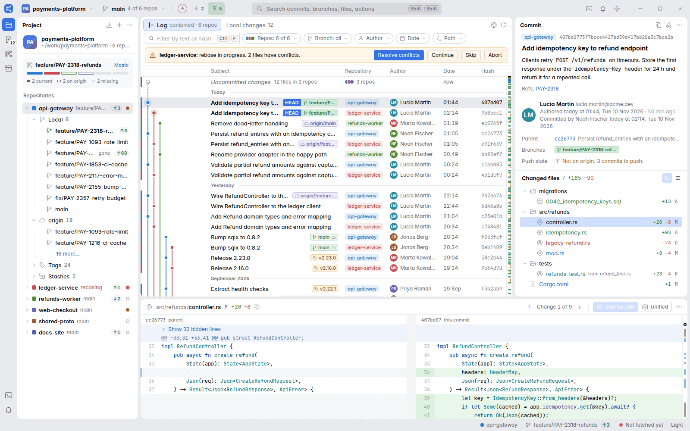

# DeepGit user guide

This guide explains how to use DeepGit.
On macOS, read `Cmd` for `Ctrl` and `Option` for `Alt` in all shortcuts.

## Contents

1. [Getting started](#1-getting-started)
2. [The window](#2-the-window)
3. [The log](#3-the-log)
4. [Details and diff](#4-details-and-diff)
5. [Local changes](#5-local-changes)
6. [Branches](#6-branches)
7. [Conflicts and operations in progress](#7-conflicts-and-operations-in-progress)
8. [Stash](#8-stash)
9. [Tags](#9-tags)
10. [Search Everywhere](#10-search-everywhere)
11. [Git console and command ticker](#11-git-console-and-command-ticker)
12. [Settings and theme](#12-settings-and-theme)
13. [Keyboard shortcuts](#13-keyboard-shortcuts)
14. [Troubleshooting](#14-troubleshooting)

---

## 1. Getting started

### Add a project folder

A project is a folder that holds one or more Git repositories.

1. Start DeepGit. The welcome screen opens when you have no project.
2. Click **Add project folder…**.
3. Choose the folder in the system dialog.

DeepGit scans the folder and finds every repository in it.
The scan goes four levels deep.
The scan includes nested repositories (a repository inside another repository).
The scan skips hidden folders and the folders `node_modules`, `target`, `dist`, `build` and `.venv`.
The scan does not follow symbolic links.

The project opens with the combined log of all repositories.
DeepGit gives each repository its own colour. The colours are bright and spread over the whole rainbow.
The colour shows as a small square, a coloured spine, and a soft tint behind the rows of that repository.

To change a colour, right-click the repository in the sidebar and choose **Set Color**. **Settings > Colors** lists all of them in one place.
Pick one of the 12 colours, choose **Auto** to go back to the automatic colour, or choose **Custom…** to type a `#RRGGBB` value.
You can also press `Shift Shift` and run **Set repository color…**.
Each project has a colour too. It tints the project button in the title bar and its row in the project switcher.
Change it in the project switcher menu (**Set Color**).
The tint is soft on purpose: text stays readable in the light and the dark theme, and hover and selection stay clear above it.

To add more projects later, use the project switcher in the title bar (`Ctrl+Alt+P`) and choose **Add project folder…**.
You can also click the **+** button in the sidebar header.

### Single repository and multi-repo projects

A project with one repository works like a normal Git client.
The log shows one repository. The repository column and the repo spine are hidden.

A project with several repositories shows all of them together:

- The log merges the commits of all repositories.
- Each commit row has a repository chip and a coloured spine.
- The sidebar lists all repositories.
- The branch matrix and the sync strip appear.
- Operations such as checkout, new branch, merge and commit can run in many repositories at once.

### Manage projects

Click the project switcher in the title bar. The menu has these items:

- The list of your projects. Click a name to switch.
- **Add project folder…**
- **Rescan \<project\>**: searches the folder again for repositories. Use it after you clone a new repository into the folder.
- **Remove \<project\>…**: removes the project from the DeepGit list. The repositories stay on disk.

---

## 2. The window

The window has these parts:

| Part | Where | What it does |
|---|---|---|
| Title bar | Top | Project switcher, branch widget, Fetch, Pull and Push buttons, Search Everywhere field, Git console button, notifications, settings, window buttons. |
| Tool stripe | Left edge | Buttons for the Project sidebar (`Alt+1`), Local changes (`Alt+0`), Branch matrix (`Alt+2`), Stashes (`Alt+3`, shows the sidebar) and Git console (`Alt+9`). Also the notifications button. |
| Sidebar | Left | The project card, the sync strip and the tree of repositories, branches, tags and stashes. |
| Main island | Centre | Two tabs: **Log** and **Local changes**. |
| Right column | Right of the main island | Two tabs. **Changed files** shows the selected commit and its changed files. **File changes** shows the diff of the selected file. |
| Bottom tool window | Below the main island and the right column | **Git console** or **Branch matrix**. It shows only when you open it. |
| Status bar | Bottom | Command ticker, focused repository, current branch, fetch age and theme switch. |

### Resize and hide panels

- Drag the gap between two panels to resize them.
- Double-click a gap to reset the panels to their default size.
- Press `Alt+1` to hide or show the sidebar.
- Press `Ctrl+D` to show the **File changes** tab. Press `Esc` in the diff to go back to **Changed files**.
- Click the maximize button next to the tabs, or double-click the **File changes** tab, to make the right column wide. Do it again to restore the width.
- Search Everywhere (**Actions** tab) lists **Show file changes**, **Show changed files** and **Maximize or restore the file changes**.
- Press `Shift+Esc` to hide the bottom tool window.

DeepGit remembers panel sizes and which panels are visible.

### Title bar buttons

- **Fetch** (`Ctrl+T`) fetches all repositories of the project. A thin ring around the icon shows how old the oldest fetch is. The ring fills over 2 hours. Its colour shows if the data is fresh (under 15 minutes), aging (up to 2 hours) or stale (older, or never fetched).
- **Pull** (`Ctrl+Shift+T` for the focused repository) shows the number of incoming commits. The button pulls the repositories that are behind. When no repository is behind, it pulls all of them.
- **Push** (`Ctrl+Shift+K` for the focused repository) shows the number of outgoing commits. The button opens the push dialog for the repositories that are ahead.
- Hover over Pull or Push to see the count for each repository.
- The **Notifications** button lists the last 12 messages of the session.

### Focused repository

Many actions work on the focused repository. This is the repository that you touched last: you selected a commit in it, or a branch or a file. The status bar shows its name.

---

## 3. The log

Open the **Log** tab in the main island.
The log header shows "combined · N repos" for several repositories, or the repository name for one.

### Rows and columns

Each commit row shows these columns:

- **Repo spine**: a 3 px bar in the colour of the repository. Only in multi-repo projects.
- **Graph**: the commit graph.
- **Subject**: the commit subject. Ref pills are at the right end.
- **Repository**: a chip with the repository name. Only in multi-repo projects.
- **Author**, **Date** and **Hash**.
- **Overview ruler**: the narrow strip at the right edge.

Right-click the column header to show or hide columns. Drag the border of a column header to resize the column. Double-click a border to reset it.

If the log is narrow, DeepGit hides the hash, author, date and repository columns, in this order, so that the subject keeps at least 200 px.

Date groups ("Today", "Yesterday", "September 2026" and so on) split the list. The current group label stays at the top while you scroll.

The first row is **Uncommitted changes** when a visible repository has local changes. Click it to open the **Local changes** tab.

### Graph

The graph draws the history as coloured lanes.
Merge commits have a hollow node. The HEAD commit has a ring around its node.
In a multi-repo project, each repository has its own group of lanes. Lane groups never connect.

By default, the lane colour is the repository colour.
To colour the lanes by branch, click the palette button in the log header.
The same switch is in **Settings** as **Colour lanes by repository**.
To hide the graph, clear **Show commit graph** in the settings.

### Ref pills

Ref pills show the branches and tags that point to a commit.

| Pill | Meaning |
|---|---|
| **HEAD** (blue) | HEAD points to this commit. When HEAD is on a branch, the HEAD pill and the branch pill join in one split pill. |
| Green with a branch icon | A local branch. The current branch is bold. |
| Purple with a cloud icon | A remote branch, for example `origin/main`. |
| Orange with a tag icon | A tag. |
| Cloud icon after a local name | The local branch and its remote branch point to the same commit. |
| **+N** | More refs than fit. Hover to see all of them. |

Right-click a pill to open the menu for that branch or tag.

### Filters

The filter bar is above the log.

| Control | What it does |
|---|---|
| Text box | Filters by commit message. A text of four or more hexadecimal characters also matches the start of a commit hash. Press `Ctrl+F` to focus it. Press `Enter` to apply now. |
| **Repos** chip | Chooses which repositories the log shows. The popup has **All** and **Only this** for each row. |
| **Branch** chip | Shows only the commits of the chosen branches. You can pick several. A branch name matches in every repository that has it. |
| **Author** chip | Shows only the commits of one author. |
| **Date** chip | Last 24 hours, last 7 days, last 30 days, last year or a custom range. |
| **Path** chip | Shows only the commits that touch a file or folder. |

You can type these prefixes in the text box:

- `author:name`
- `path:src/refunds`
- `after:2026-10-01`
- `before:2026-11-01`

Dates use the form `YYYY-MM-DD`. Use quotes for values that contain spaces, for example `author:"Lucía Martín"`.

When a filter is on, its chip is highlighted. Click the **x** on a chip to clear it.
Press `Ctrl+Shift+F` to clear all filters, including the repository filter.
DeepGit hides the "Uncommitted changes" row while a text, branch, author, date or path filter is on.

### Repo spine

In a multi-repo project, the spine tells you which repository owns a commit without reading the chip.

- Click the spine to show only that repository.
- `Alt`+click the spine to add the repository to the filter or to remove it.

### Overview ruler

The overview ruler is a map of the whole history.
It marks HEAD, branch tips, tags, the selected commit and repositories with conflicts.
Hover a mark to see its name. Click a mark to jump to that commit and select it.

### Select commits

- Click a row to select a commit. The **Changed files** tab follows.
- `Ctrl`+click adds or removes a commit.
- `Shift`+click selects a range (up to 2000 rows).
- Use `↑`, `↓`, `PgUp`, `PgDn`, `Home` and `End` to move.
- Press `H` to select the HEAD commit.
- Press `P` to select the first parent of the selected commit.
- Press `Alt+←` and `Alt+→` to go back and forward in your selection history.
- Press `Enter` or double-click a row to move the focus to the file list in the details island.
- Press `Ctrl+Shift+C` to copy the full hash.
- Press `Ctrl+G` to go to a commit by hash. It opens Search Everywhere on the **Commits** tab.
- Press `Esc` in the **Changed files** tab to move the focus back to the commit list. In the **File changes** tab, `Esc` goes back to **Changed files** first.

### Context menu of a commit

Right-click a commit. The menu has these items:

- **Copy hash**, **Copy subject**
- **Checkout revision** (detached HEAD at this commit)
- **New branch here…**, **New tag here…**
- **Branch X** submenus (up to four branches on the commit): checkout, merge into the current branch, rebase the current branch onto it
- **Cherry-pick onto \<branch\>**
- **Revert commit**
- **Reset \<branch\> to here…**
- **Interactive rebase from here…** (disabled, planned for a later version)
- **Show only \<repo\> in the log** (multi-repo only)

When you select several commits in one repository, the menu has **Cherry-pick N commits** and **Copy hashes**.

### Refresh

The log reloads by itself when HEAD or a branch changes.
Click the refresh button in the log header, or press `Ctrl+R`, to reload by hand.

---

## 4. Details and diff

### Commit details

Select a commit. The details island shows:

- The repository chip and the full hash. Click the hash to copy the short hash.
- The subject and the message body. Code in `backticks` and web addresses in the message are formatted. Click a web address to open it in your browser.
- The author and the committer, with dates. The committer shows only when it differs from the author.
- **Parents**. Click a parent hash to select that commit in the log.
- **Branches** that contain the commit.
- **Tags**, if any.
- **Push state**: "Not on origin. 3 commits to push." or the remote branch that has the commit.
- **Changed files** with the number of added and removed lines.

Use the two buttons at the right of **Changed files** to switch between a tree and a flat list.
For a merge commit, choose which parent to compare against with **Changes against**.

The header buttons copy the hash, cherry-pick the commit onto the current branch, and open a **More** menu.

Click a file, or press `Enter` on it, to show its diff in the **File changes** tab. The arrow keys only move the selection. Right-click a file to copy its path.

If you select another commit while a file is open, the file stays open when the new commit changes the same path (you see its change in the new commit). If it does not, DeepGit goes back to **Changed files**.

### Diff viewer

The **File changes** tab shows the diff of the selected file. Both tabs stay alive, so the diff keeps its scroll position when you switch.
The header shows the file path, the status letter, the number of added and removed lines, and the layout switch.

- **Side by side** and **Unified** are the two layouts. Press `Ctrl+Alt+D` to switch. When the diff is narrower than 720 px, DeepGit shows **Unified** by itself, unless you chose a layout in this session. Maximize the column to get more room.
- Press `F7` for the next change and `Shift+F7` for the previous change. The header shows "Change 3 of 9".
- Unchanged lines far from a change are folded. Click **Show N hidden lines** to unfold them.
- Changed words are highlighted inside changed lines. DeepGit does not highlight words when more than 60 % of the line changed.
- The ruler at the right edge shows all changes. Click a mark to jump to it.

Click the **More** button in the diff header to open the options:

- **Ignore whitespace**: Off, Trailing or All. Press `Ctrl+Alt+W` to switch between Off and All.
- **Word diff**
- **Syntax colours**
- **Collapse unchanged lines**
- **Show line numbers**
- **Copy path**

DeepGit remembers these options.

Large and binary files:

- A diff with more than 5000 changed lines shows a **Show diff** button first.
- A diff with more than 20 000 lines is not shown. Use a terminal or an external diff tool.
- A binary file shows "Binary file".

### Stage, unstage and discard hunks

When the **File changes** tab shows a file from **Local changes**, each hunk has buttons at its top right.

- For an unstaged file: **Stage** and **Discard**.
- For a staged file: **Unstage**.

**Discard** asks for confirmation. You cannot undo a discard.
DeepGit refuses to apply a hunk that no longer matches the file, for example after the file changed on disk. Select the file again and retry.

---

## 5. Local changes

Open the **Local changes** tab or press `Alt+0`.
The tab shows the repositories that the log shows. Each repository with changes has its own group.

### Files

Each group has up to three sections:

- **Conflicts**: files with merge conflicts.
- **Staged**: changes that go into the next commit.
- **Unstaged**: changed files and new (untracked) files.

Use the two buttons above the list to group files by folder or to show a flat list.

Status letters: `A` added, `M` modified, `D` deleted, `R` renamed, `C` copied, `T` type change, `U` conflict, `?` untracked.

### Stage and unstage

- Click the checkbox at the left of a file, folder, section or repository to stage or unstage it.
- Select files and press `Space` to stage or unstage them.
- Click the **+** button of a section, or press `Ctrl+Alt+A`, to stage all changes.
- Click the **−** button of the **Staged** section to unstage all.
- Select a file to see its diff in the **File changes** tab of the right column. Press `Enter` or double-click a file to show the diff.
- Use `Ctrl`+click, `Shift`+click, `Ctrl+A` and `Shift+↑` / `Shift+↓` to select several files.
- Use `←` and `→` to collapse and expand folders.

To stage only a part of a file, use the **Stage** button on a hunk in the **File changes** tab. See [section 4](#stage-unstage-and-discard-hunks).

### Discard

- Select unstaged files and press `Delete`, or click the discard button on the row.
- DeepGit asks for confirmation. The dialog names the files.
- DeepGit deletes untracked files that you discard.
- You cannot undo a discard.
- DeepGit does not discard staged files. Unstage them first.

### Commit

1. Stage the files that you want to commit.
2. Click the commit message box or press `Ctrl+M`.
3. Write the message. The counter shows the length of the first line. It turns to a warning above 72 characters.
4. Click **Commit** or press `Ctrl+Enter`.

The line above the message box shows where the commit goes.
For a single repository it shows the branch name.

DeepGit keeps your message as a draft for each project until you commit.

### Commit and push

Click **Commit and Push** or press `Ctrl+Alt+K`.
DeepGit commits first. Then it opens the push dialog for the repositories that committed.

### Amend

1. Select **Amend**.
2. If the message box is empty, DeepGit fills it with the last commit message.
3. Click **Amend commit** (or **Amend and Push**).

When nothing is staged, Amend changes only the message of the last commit.
Amend rewrites the last commit. Do not amend a commit that you already pushed, unless you plan to force-push.

### Multi-repo commit

When files are staged in more than one repository, one message goes to all of them.
The button reads **Commit in 3 repos**.
The line above the message box lists the repositories.
The console shows one `git commit` command for each repository.
DeepGit skips repositories with nothing staged.

---

## 6. Branches

### The sidebar tree

Expand a repository in the sidebar to see:

- **Local**: local branches. The current branch is bold and has a green icon. A **gone** tag means that the upstream branch no longer exists on the remote. The capsule `↑3 ↓1` shows commits to push and to pull.
- **origin** and other remotes: remote branches.
- **Tags**
- **Stashes**
- **Submodules**, if the repository has any.

Each repository row shows its name, its current branch, the capsule for ahead and behind, and a state dot:

- Ring: the working tree is clean.
- Orange dot: the repository has local changes.
- Red dot: a merge, rebase or similar operation is in progress, or the repository has conflicts.

Actions in the tree:

- **Double-click a local branch** to check it out.
- **Double-click a remote branch** to create a local tracking branch and check it out. A dialog asks for the local name.
- **Double-click a repository** (multi-repo projects) to show only that repository in the log.
- **Click the colour square** of a repository to show or hide it in the log. `Alt`+click shows only this repository.
- **Type letters** to filter the tree (speed search). `Backspace` removes a letter. `Esc` clears the search.
- Press `F2` to rename the selected branch.
- Press `Delete` to delete the selected branch, delete the selected tag or drop the selected stash. DeepGit asks first.
- **Right-click** any item for its menu.

The menu of a local branch has these items. Each item names the branches it acts on.

- Checkout, **New branch from X…**, **Checkout X and rebase onto Y**
- **Merge X into Y**, **Rebase Y onto X**
- **Push…**, **Pull X** (current branch only)
- **Rename…** (`F2`), **Delete…** (`Delete`)
- In multi-repo projects: **Checkout X in all N repos that have it** and **New branch from X in N repos…**

### Branch popup

Click the branch widget in the title bar, or press ``Ctrl+Shift+` ``, to open the branch popup.

- Type to search branches in all repositories.
- Sections: **Recent**, **Local**, **Remote** and **Tags** (tags show when you search).
- In a multi-repo project, each row shows coloured dots for the repositories that have the branch, and a count such as `4/6`.
- Press `Enter` to check out the branch in every repository that has it.
- Press `→` to list the repositories of the branch. Press `←` to close the list.
- Right-click a row for the branch menu. The menu can check out the branch in one repository only.
- Type a new name and choose **New branch …** to create it.

The footer has three actions:

- **New branch…** creates a branch in all repositories.
- **Checkout tag or revision…** checks out a tag, a commit hash or any other revision in the focused repository.
- **Open branch matrix** opens the matrix.

### Branch matrix

Press `Alt+2` or click the matrix button in the tool stripe.
The matrix opens in the bottom tool window.

The rows are repositories. The columns are branches.
By default the matrix shows only branches that exist in two or more repositories. Clear **Only branches in 2+ repos** to see all branches.
Use the filter box to search branch names.

Each cell shows one symbol:

| Symbol | Meaning |
|---|---|
| Filled dot | The branch is checked out. |
| Ring | A local branch exists. |
| Dashed ring | The branch exists only on `origin`. |
| Dash | The branch does not exist in this repository. |
| Red dot | The repository has an operation in progress. Batch operations skip it. |

A cell can also show the ahead and behind capsule. Hover over a cell for details.

To run an operation on many repositories:

1. Click a column header. The column is selected. Use `←` and `→` to move to the next column. Press `Esc` to clear the selection.
2. Use a button in the bar at the bottom:
   - **Checkout in N repos**: checks out the branch where it exists. Where it exists only on `origin`, DeepGit creates a tracking branch.
   - **Create in N missing repos from…**: creates the branch where it is missing. You choose the base: the default branch of each repository, or another branch.
   - **Pull in N repos**: pulls the repositories where the branch is checked out.
   - **Push in N repos**: opens the push dialog for the repositories that have commits to push.
   - **Merge into current**: merges the branch into the checked-out branch of each repository. A dialog opens first.
   - **Delete in N repos…**: deletes the local branch where it is not checked out. DeepGit asks first.
3. Before a checkout in several repositories, and before a create, a confirmation dialog lists one `git` command for each repository.
4. During the run, a line moves down the column. A failed cell gets a red ring. Hover over it to read the error.
5. One message at the end gives the summary.

DeepGit skips a repository when the operation does not apply to it. A skip is not a failure. Examples: the branch is missing, or a merge or rebase is in progress.

Double-click a cell to check out the branch in that repository only.

### Sync strip

When the project has several repositories and the current branch of the focused repository exists in at least two of them, the sidebar shows the sync strip.
It has one segment for each repository:

- Filled with the repository colour: the branch is checked out.
- Dimmed colour: the branch is local but not checked out.
- Outline only: the branch exists only on `origin`.
- Grey: the branch is missing.

Click a segment to focus that repository. Click **Matrix** to open the matrix with this branch selected.

### Dialogs and command preview

Every operation that needs a choice opens a dialog.
Each dialog shows the exact `git` commands at the bottom.
The preview changes when you change an option.
Click the copy icon to copy the commands.
Press `Enter` to run the main action. Press `Esc` to cancel.

| Dialog | Options |
|---|---|
| **New branch** | Name (checked with the rules of Git), start point, **Check out the new branch**, and a list of repositories in multi-repo mode. |
| **Check out remote branch** | Name of the new local branch. It tracks the remote branch. |
| **Rename branch** | New name. **Also rename `<remote>/<branch>`** shows the full name of the remote branch that is renamed (see the delete rule below). |
| **Merge** | Fast-forward when possible, always create a merge commit, or squash. |
| **Rebase** | Target branch. The command preview shows `--autostash`. A warning appears when the branch has an upstream, because rebase rewrites commits. |
| **Reset** | Soft, Mixed, Hard or Keep. A red warning shows for Hard. |
| **Push** | Remote, the commits to push, **Set upstream**, **Push tags**, **Force with lease**. |
| **Stash** | Message, **Include untracked files**, **Keep index**. |
| **New tag** | Name, target and an optional message. A message makes an annotated tag. |

DeepGit never uses a plain force push. The only force option is **Force with lease**. It overwrites the remote branch only when nobody else pushed to it since your last fetch.

DeepGit always runs a rebase with `--autostash`. There is no option for it: local changes are stashed and restored automatically.

### Delete

- **Delete branch** asks for confirmation. You can also delete the remote branch and force the delete for unmerged branches. The checkbox shows the full name, for example **Also delete origin/feature**. The remote branch that goes with a local branch is its upstream only when the upstream has the same branch name. A `feature` branch that tracks `origin/develop` never deletes `develop`. Otherwise it is `origin/<name>`, and only when that branch exists. When there is no such branch the checkbox is not shown. **Rename branch** uses the same rule.
- **Delete … on the remote…** runs `git push <remote> --delete <branch>`. Only branches of `origin` can be deleted from the sidebar.
- You cannot delete the current branch.

### Fetch, pull and push

- **Fetch** (`Ctrl+T`) runs `git fetch --prune --all` in all repositories. The status bar shows how old the oldest fetch is. Click it to fetch again.
- **Pull** runs `git pull --no-edit --ff`. DeepGit skips repositories without an upstream branch.
- **Push** opens the push dialog. DeepGit pushes branches without an upstream with `-u`. DeepGit skips repositories with nothing to push.
- A branch whose upstream has another name (for example `myfix` tracking `origin/main`) is never pushed to that upstream. DeepGit pushes it to `origin/myfix` with `-u`, so it tracks that branch from then on. The dialog explains this and the notification says, for example, "Pushed myfix to new origin/myfix (it tracked origin/main)".
- Remote names may contain a slash, for example `team/fork`. DeepGit finds the remote by its configured name, not by the first slash.
- At most four repositories run at the same time. A progress widget in the status bar shows the count.
- When a remote needs a login, DeepGit asks. See [Sign in to a remote](#sign-in-to-a-remote).

### Sign in to a remote

When `git` or `ssh` needs a secret during a fetch, pull, push or clone that you started, DeepGit opens a dialog.
Git first tries your SSH agent and your Git credential helper. The dialog appears only when they cannot answer.

| Dialog | What it asks | Remember |
|---|---|---|
| **Log in to github.com** | HTTPS user name and password or token, in one dialog | The password is saved with the user name |
| **Log in to github.com** (user name in the URL) | The password or token only. The user name is shown | Yes |
| **Unlock SSH key ~/.ssh/id_ed25519** | The passphrase of the key | Yes, for this key file |
| **Log in to host** (SSH password) | The password of `user@host` | Yes |
| **Unknown host** | The fingerprint of an SSH host that is not in `known_hosts`. **Accept** adds it. **Reject** stops the command | No |

- The field is masked. Click the eye to show the text.
- Many hosts need a personal access token instead of a password. Paste the token in the password field.
- **Remember** is on by default. DeepGit saves the secret in the system key store: Secret Service on Linux (GNOME Keyring, KWallet), Keychain on macOS, Credential Manager on Windows. It saves only after the command succeeded.
- Next time DeepGit uses the saved login without a dialog. When the remote rejects it, DeepGit deletes the saved login and asks again.
- Without a key store (for example a server without Secret Service) the checkbox is hidden, DeepGit shows one notice, and you type the secret each time.
- Several repositories can ask at the same time (a fetch of all repositories). DeepGit shows the dialogs one by one.
- The 120 second timeout does not run while a dialog is open. If you do not answer for 5 minutes, DeepGit cancels the command.
- **Cancel** stops the command with the message "No credentials were given."
- Background fetches never open a dialog. They use only saved HTTPS logins and SSH agent keys.
- DeepGit never writes the secret in the Git console. It goes straight from the dialog to `git`.
- **Settings > Git > Credentials** has the switch **Save passwords in the system key store** (default on). Off: DeepGit still asks, but it never reads or saves a login.
- **Forget saved logins…** (same page) removes every login that DeepGit saved. DeepGit asks you to confirm first and then shows how many entries it removed.
- When there is no key store, the same page shows a note.

---

## 7. Conflicts and operations in progress

A merge, rebase, cherry-pick or revert can stop because of conflicts.

When a repository is in this state:

- The log shows a banner: "**ledger-service**: rebase in progress. 2 files have conflicts."
- The sidebar shows the state and a red dot.
- The **Local changes** tab shows a banner with the same buttons.
- With more than two such repositories, the log shows one banner: "3 repos have an operation in progress." Click **Show** to see them.

### Banner buttons

| Button | What it does |
|---|---|
| **Resolve conflicts** | Opens the **Conflicts** dialog for that repository. |
| **Continue** | Continues the operation. In **Local changes**, the button is off while conflicts remain. |
| **Skip** | Skips the current step. Only for rebase and cherry-pick. |
| **Abort** | Cancels the operation. DeepGit asks first. The conflict resolutions that you made are lost. |

### Resolve conflicts

DeepGit has a conflicts dialog and a three-pane merge window. You do not need an external editor.
Open the dialog with **Resolve conflicts** in a banner, with **Resolve conflicts…** in the banner of the **Local changes** tab,
or from Search Everywhere (type "Resolve conflicts").

#### Yours and Theirs

- **Yours** is your side. **Theirs** is the other side.
- In a merge, Yours is the branch you are on and Theirs is the branch you merge in.
- In a cherry-pick or a revert, Theirs is the commit.
- **In a rebase the sides swap.** Git replays your commits on top of the other branch, so in a rebase **Yours is your commit**
  that is being replayed and **Theirs is the branch you rebase onto**. DeepGit does the swap for you and writes
  "your commit" and "upstream" in the headers of the merge window. "Accept Yours" always keeps the change that you made.

#### The Conflicts dialog

The dialog lists the files with conflicts, grouped by repository. A line above each group names the branches.
The columns **Yours** and **Theirs** tell what each side did to the file: **Modified**, **Added** or **Deleted**.
A file that is binary shows a **binary** tag.

| Button | What it does |
|---|---|
| **Accept Yours** | Keeps your whole version of the selected files and stages them. If you deleted a file, it is deleted. |
| **Accept Theirs** | Keeps their whole version of the selected files and stages them. If they deleted a file, it is deleted. |
| **Merge…** | Opens the merge window for the selected file. Double click on a file or `Enter` does the same. |
| **Resolve simple conflicts automatically** | Merges every text file whose changes do not collide. A file is saved only when it ends fully resolved. The others stay in the list. |

Select several files with `Ctrl`+click, `Shift`+click or `Ctrl+A`. When the last conflict is resolved, the dialog offers **Continue merge**
(or rebase, cherry-pick, revert). In **Local changes**, a file in the **Conflicts** section has the buttons **Yours**, **Theirs** and **Merge…**
on hover, and the same commands are in its context menu. A double click on the file opens the merge window.

#### The merge window

The window has three panes: **Yours** on the left, **Result** in the middle and **Theirs** on the right. The headers show the branch
or commit of each side. The two outer panes are read only. The **Result** is an editor that you can type in. It starts as the common
ancestor (the "base") of both sides. The panes scroll together.

Colours show what changed: **red** is a conflict (both sides changed the lines in different ways), **blue** is a change, **green** is a
new line and **grey** is a deleted line. The bands between the panes join each change to its place in the Result.

For each change, the gutters show two buttons:

| Button | What it does |
|---|---|
| **»** (left) or **«** (right) | Applies this side to the Result. In a conflict, the other side stays open. Click the other side too to keep both: **Yours first, then Theirs**. `Shift`+click applies the side and closes the change. |
| **×** | Ignores this side. The Result stays as it is. |

A conflict is solved when both of its sides are applied or ignored. A change that only one side made is solved with one click.
If you type inside a change, it counts as solved by you. If you undo the typing, it is open again.

The toolbar:

| Control | What it does |
|---|---|
| **Apply non-conflicting** **Yours**, **All**, **Theirs** | Applies every change that only that side made (or only one side made, for **All**). Conflicts are not touched. |
| **Magic resolve** | Merges a conflict at word level when the two sides changed different words, for example one changed a name and the other a number on the same line. It never resolves a conflict when both sides changed the same word, or when one side deleted lines. |
| **↑** **↓** | Previous and next change. Keys: `Shift+F7` and `F7`, or `Alt+↑` and `Alt+↓`. |
| Counter | "2 conflicts left", then "All changes processed". |
| **Accept Yours**, **Accept Theirs** | Replaces the Result with that whole version. DeepGit asks first when you already changed something. |
| **Reset** | Goes back to the base with all changes open. |

Undo (`Ctrl+Z`) and redo (`Ctrl+Shift+Z`) work in the Result, also for the buttons above.

**Apply** saves the Result and stages the file. If conflicts are still open, DeepGit asks "Save with unresolved conflicts?".
If you agree, the file is saved with the usual markers (`<<<<<<<`, `=======`, `>>>>>>>`) around each open conflict. It is **not**
staged and stays in the list. Changes that only one side made and that you did not ignore are applied when you click **Apply**.
**Cancel** closes the window. DeepGit asks first when you changed something.

The file keeps its line ending (LF or CRLF) and its file mode. DeepGit refuses to save when the conflict changed in the meantime
(for example because you continued the rebase in a terminal): close the window and open it again.

#### Files that cannot be merged line by line

- **One side deleted the file.** The window shows both sides and two buttons: **Keep this version** and **Delete the file**.
- **Binary files, files that are not UTF-8 text, files over 2 MiB, symbolic links and submodules.** The window shows the size of each
  side and the same two choices. DeepGit never rewrites such a file from text, so the bytes of the side you pick are kept.

#### Keys in the merge window

| Key | Action |
|---|---|
| `F7`, `Alt+↓` | Next change |
| `Shift+F7`, `Alt+↑` | Previous change |
| `Alt+→` | Apply Yours to the current change (`Shift` also closes it) |
| `Alt+←` | Apply Theirs to the current change |
| `Ctrl+Enter` | Apply (save) |
| `Esc` | Cancel |

The current change is the one under the cursor in the Result, or the one you went to last. Its edges are drawn thicker.

---

## 8. Stash

A stash saves your local changes and cleans the working tree.

- To stash, press `Ctrl+Alt+Z`, click **Stash changes** in the **Local changes** tab, or use **Stash changes…** in a repository menu.
- The dialog has **Include untracked files** and **Keep index**. It shows the command.
- In multi-repo projects, the palette action **Stash changes in all repositories…** stashes all repositories.
- Stashes appear in the sidebar under **Stashes** in each repository. The **Local changes** tab shows the number of stashes.

Right-click a stash in the sidebar:

- **Apply** applies the stash and keeps it.
- **Pop** applies the stash and removes it.
- **Drop…** removes the stash. DeepGit asks first. You cannot restore a dropped stash.

Double-click a stash to apply it. Press `Delete` on a stash to drop it.

DeepGit checks that the stash list did not change since it listed the stash. If it changed, DeepGit shows "The stash list changed. Reload."

---

## 9. Tags

- Right-click a commit and choose **New tag here…**. Or use the palette action **New tag on HEAD…**.
- Enter a name. Add a message to make an annotated tag.
- Tags show in the log as pills and in the sidebar under **Tags**.
- Right-click a tag to check it out, to create a branch from it, to push tags, to delete it or to copy its name.
- Double-click a tag to check it out (detached HEAD).
- Press `Delete` on a tag in the sidebar to delete it. DeepGit asks first.

---

## 10. Search Everywhere

Press `Shift` twice quickly, or press `Ctrl+K`. You can also click the search field in the title bar.
Press `Ctrl+Shift+A` to open it on the **Actions** tab.
Press `Ctrl+G` to open it on the **Commits** tab and go to a commit by hash.

The tabs are **All**, **Commits**, **Branches**, **Files**, **Actions** and **Repos**.
Press `Tab` and `Shift+Tab` to change the tab.

Type a prefix to search one kind of item:

| Prefix | Searches |
|---|---|
| `#` | Commits, by message or hash |
| `@` | Commits, by author |
| `/` | Changed files (the files in the working trees and in the selected commit) |
| `>` | Actions |
| `:` | Repositories |

Press `Backspace` on an empty query to remove the prefix.

Use `↑`, `↓`, `PgUp` and `PgDn` to move. Press `Enter` to open the result. Press `Esc` to close.

What a result does:

- **Commit**: selects it in the log.
- **Branch**: checks it out in all repositories that have it. For a remote branch, it opens the dialog for a tracking branch.
- **File**: opens its diff.
- **Action**: runs it. The shortcut shows at the right.
- **Repo**: shows only this repository in the log and focuses it.

The palette remembers your last ten picks.
Actions without a shortcut live only here, for example **Resolve conflicts…**, **Add project…**, **Rescan project for repositories**, **Toggle commit graph**, **Push all repositories…** and **Toggle dark / light theme**.

---

## 11. Git console and command ticker

Press `Alt+9` or click the console button in the title bar.
The console opens in the bottom tool window.

Each command is one row with the time, the repository chip, the command, the duration and the exit code (✓ or ✗).
Click a row to see its output (stdout and stderr). Each output has a **Copy** button.

The toolbar has:

- A text filter.
- **Show background commands**: shows the read-only commands that DeepGit runs by itself (`status`, `log`, `for-each-ref` and others). They are hidden by default.
- **Errors only**
- **Clear**
- **Copy all**

The console keeps the last 500 commands.
DeepGit replaces credentials in URLs with `***`, for example `https://***@host/repo.git`.

The **command ticker** is the left end of the status bar.
It shows the last command that an action of yours started, with its result and duration.
For a command that ran in many repositories, it shows "× 6".
Click the ticker to open the console.

Copy a command from the console to repeat it in a terminal.

---

## 12. Settings and theme

Press `Ctrl+Alt+S` or `Ctrl+,` to open **Settings**. You can also click the gear in the title bar and choose **Settings…**, or type "settings" in Search Everywhere.

Settings is a large window. The list of pages is at the left. Type in the **Filter sections** field to find a page by name or by a word like "font" or "zoom". The page is at the right. Use `Up` and `Down` in the list to change page.

Every change applies **at once**. There is no OK button. Press `Esc` or click **Close** when you are done. DeepGit remembers all settings between sessions.

### Reset

- **Reset to defaults** (top right of a page) puts the settings of that page back to their default values.
- **Reset all** (bottom left) puts every setting back to its default value. DeepGit asks you to confirm first.

### Appearance

| Setting | Values |
|---|---|
| **Color theme** | Dark, Light, System (follows the operating system) |
| **Font size** | 10 to 20 px, default 13. Use the slider or the `-` and `+` buttons, or type a number. |
| **Editor font size** | 10 to 20 px. Diff, console and commit hashes. By default it follows the font size. Clear **Follow the font size** to choose a value. |
| **UI scale** | 80% to 200% in steps of 10%, default 100%. Zooms the whole window. |
| **Comfortable rows** | Taller rows in the log |
| **Date format** | Relative (4 min ago) or Absolute (10 Nov 2026 10:42) |

The preview under **UI scale** shows the sizes you choose.

**Font size** makes the text bigger. Rows, buttons, icons and bars grow with it, so the text does not get cut off. **UI scale** is different: it zooms everything, including lines and spaces.
If your eyes get tired, try **Font size** 15 or 16 first.

In the log, the column widths stay the same when you change the font size. If a name is cut off, drag the column border, or right-click the column header and choose **Reset column widths**.

### Log

| Setting | Values |
|---|---|
| **Show the commit graph** | On or off |
| **Lane colors** | By repository, or by branch |

### Console

| Setting | Values |
|---|---|
| **Show background commands** | Show the commands that DeepGit runs by itself (status, log, ...). Off: only your commands. |

### Git

| Setting | Values |
|---|---|
| **Auto-fetch** | Off, or every 5, 15, 30 or 60 minutes (default 15). DeepGit fetches all repositories of the project in the background. It never opens a login dialog: it uses saved logins and SSH agent keys only. A repository that fails waits longer before the next try. |
| **Prune on fetch** | Auto-fetch also removes remote branches that no longer exist. Default on. Needs auto-fetch. |
| **Sign-off commits by default** | The **Sign-off** box of the commit box starts ticked. Default off. |
| **Save passwords in the system key store** | Default on. See [Sign in to a remote](#sign-in-to-a-remote). |
| **Forget saved logins…** | Removes every saved login after you confirm. |

If the system key store is missing, a note says that DeepGit asks for the login every time.

### Colors

| Setting | Values |
|---|---|
| **Repository tint strength** | 0% to 200% in steps of 25%, default 100%. How strongly rows and headers are tinted with the colour of their repository. **Off** (0%) removes the tints. |
| Colors of the project | A list with the project and each of its repositories. Each row shows the colour and has a **Change…** button. The menu has the 12 colours, **Auto** and **Custom…**, like **Set Color** in the sidebar. |
| **Reset all colors to Auto** | Puts the project and its repositories back to the automatic colours. DeepGit asks you to confirm first. |

**Reset to defaults** on this page puts only the tint strength back to 100%. Your colours are not settings: use **Reset all colors to Auto** for them.

### Quick settings in the gear menu

The gear menu keeps the most used switches: theme, commit graph, lane colours, comfortable rows and background commands.
You can also click the theme name (**Dark** or **Light**) at the right end of the status bar to switch the theme.

### Zoom keys

| Key | Action |
|---|---|
| `Ctrl+=` or `Ctrl++` | Zoom in (UI scale +10%) |
| `Ctrl+-` | Zoom out (UI scale -10%) |
| `Ctrl+0` | Reset the UI scale to 100% |

The numeric keypad `+` and `-` work too. A short message shows the new value. The keys work in text fields and while Settings is open.

Other choices that DeepGit remembers:

- Diff layout and diff options (in the diff header).
- Log columns and their widths (right-click the column header).
- Layout of the **Local changes** tab (tree or flat).
- Panel sizes and visible panels.
- Commit message draft for each project.

---

## 13. Keyboard shortcuts

Plain keys and `Ctrl` shortcuts do not work while you type in a text field, unless the table says so. `Alt` shortcuts always work.
While a menu, popup or dialog is open, most shortcuts do not work.

### Global

| Key | Action |
|---|---|
| `Shift` `Shift` or `Ctrl+K` | Search Everywhere |
| `Ctrl+Shift+A` | Find action (Search Everywhere, Actions tab) |
| `Ctrl+G` | Go to commit / hash (Search Everywhere, Commits tab) |
| `Ctrl+Alt+P` | Switch project |
| ``Ctrl+Shift+` `` | Branch popup |
| `Ctrl+T` | Fetch all repositories |
| `Ctrl+Shift+T` | Pull the focused repository |
| `Ctrl+Alt+Shift+T` | Pull all repositories |
| `Ctrl+Shift+K` | Push the focused repository |
| `Ctrl+Alt+N` | New branch (focused repository, from HEAD) |
| `Ctrl+Alt+Z` | Stash changes (focused repository) |
| `Ctrl+R` | Refresh |
| `Ctrl+Alt+S` or `Ctrl+,` | Settings |
| `Ctrl+=` or `Ctrl++`, `Ctrl+-`, `Ctrl+0` | Zoom in, zoom out, reset zoom (UI scale). These work in text fields and in dialogs. |

### Tool windows

| Key | Action |
|---|---|
| `Alt+1` | Show or hide the sidebar |
| `Alt+0` | Switch between **Local changes** and **Log** |
| `Alt+2` | Show or hide the branch matrix |
| `Alt+3` | Show the sidebar (stashes) |
| `Alt+9` | Show or hide the Git console |
| `Ctrl+D` | Show the **File changes** tab (the diff) |
| `Shift+Esc` | Hide the bottom tool window |
| `Esc` | In the **File changes** tab: back to **Changed files**. In **Changed files**: return the focus to the log |

### Log

| Key | Action |
|---|---|
| `↑` `↓` | Previous or next commit |
| `PgUp` `PgDn` `Home` `End` | Move by page, to the first row, to the last row |
| `Shift+↑` `Shift+↓` | Extend the selection |
| `Ctrl+F` | Focus the text filter (also works in text fields) |
| `Ctrl+Shift+F` | Clear all filters |
| `Ctrl+G` | Go to commit / hash (Search Everywhere, **Commits** tab) |
| `Ctrl+Shift+C` | Copy the hash of the selected commit |
| `Enter` | Move the focus to the file list of the commit |
| `H` | Select HEAD |
| `P` | Select the first parent |
| `Alt+←` `Alt+→` | Back or forward in the selection history |

### Local changes

| Key | Action |
|---|---|
| `↑` `↓` `PgUp` `PgDn` `Home` `End` | Move in the file list |
| `←` `→` | Collapse or expand a folder, section or repository |
| `Space` | Stage or unstage the selected files |
| `Delete` | Discard the selected files (asks first) |
| `Enter` | Show the diff of the file |
| `Ctrl+A` | Select all files |
| `Ctrl+Alt+A` | Stage all changes |
| `Ctrl+M` | Focus the commit message |
| `Ctrl+Enter` | Commit (also works in the message box) |
| `Ctrl+Alt+K` | Commit and push (also works in the message box) |

In the **Conflicts** section, double click on a file opens the merge window. See [Resolve conflicts](#resolve-conflicts).

### Diff

| Key | Action |
|---|---|
| `F7` | Next change |
| `Shift+F7` | Previous change |
| `Ctrl+Alt+D` | Side by side or unified |
| `Ctrl+Alt+W` | Ignore whitespace on or off |

The diff shortcuts act on the diff viewer that you used last.

### Sidebar tree

| Key | Action |
|---|---|
| `↑` `↓` | Move |
| `←` `→` | Collapse or expand |
| `Enter` | Open the item (check out a branch or tag, apply a stash) |
| Letters | Speed search |
| `Esc` | Clear the speed search |
| `F2` | Rename the selected branch |
| `Delete` | Delete the selected branch or tag, or drop the selected stash (asks first) |

### Popups, matrix and dialogs

| Where | Key | Action |
|---|---|---|
| Branch popup | `↑` `↓` | Move |
| Branch popup | `Enter` | Check out the branch |
| Branch popup | `→` `←` | Open or close the list of repositories |
| Branch matrix | `←` `→` | Select the previous or next column |
| Branch matrix | `Esc` | Clear the column selection |
| Search Everywhere | `Tab` `Shift+Tab` | Next or previous tab |
| Search Everywhere | `Enter` | Open the result |
| Search Everywhere | `Esc` | Close |
| Dialog | `Enter` | Run the main action |
| Dialog | `Esc` | Cancel |
| Conflicts dialog | `↑` `↓` `Enter` `Ctrl+A` | Move, open the merge window, select all files |
| Merge window | `F7` `Shift+F7` | Next and previous change |
| Merge window | `Alt+→` `Alt+←` | Apply Yours or Theirs to the current change |
| Merge window | `Ctrl+Enter` `Esc` | Apply (save), cancel |
| Menu | `↑` `↓` `→` `←` `Enter` `Esc` | Move, open or close a submenu, choose, close |

---

## 14. Troubleshooting

### Authentication fails

DeepGit asks for the login when `git` or `ssh` needs it (see [Sign in to a remote](#sign-in-to-a-remote)).
You can see one of these messages:

- "Authentication failed. Check your user name and password or token, then try again." The remote refused the login. DeepGit deleted the saved login. Run the command again and type the right one.
- "No credentials were given. Run the command again and enter them, or set up a credential helper or an SSH agent." You cancelled the dialog, or a background fetch had no saved login.
- "SSH authentication failed (permission denied). Check the passphrase of your key, or load the key in an SSH agent." The server does not accept your key. Check that the public key is on the server.

To check outside DeepGit:

1. Open a terminal.
2. Run `git fetch` in the repository. When it works there, it works in DeepGit.
3. For an HTTPS remote that rejects your password, create a personal access token on the host and use it as the password.
4. For an SSH remote, `ssh -T git@host` shows whether the key works.

DeepGit starts `ssh` with its own `SSH_ASKPASS` program, so it does not read from a terminal. If you set `GIT_SSH_COMMAND`, `GIT_SSH` or `core.sshCommand`, DeepGit keeps your command.

### A network command times out

DeepGit stops `fetch`, `pull` and `push` after 120 seconds without output, or after 60 minutes in total.
The error reads "git fetch timed out after 120 s".
A login dialog that is open does not count as silence.
DeepGit also stops the programs that `git` started, such as `ssh`.
Check your network, your VPN and the remote address. Then try again.

### The remote has new commits

The message "Push rejected: the remote has new commits. Pull first." means that your branch is behind.
Pull, resolve any conflicts, then push again.

### The log does not update after I edit files

DeepGit watches your working trees with the file watcher of the operating system.
On Linux, each user has a limit for watched folders (`fs.inotify.max_user_watches`).
When the limit is reached, DeepGit stops adding watches. A single repository gets at most 20 000 watched folders.
Changes made by Git itself (commit, checkout, fetch) still refresh the view.
Edits in the working tree may not refresh by themselves.

To fix this:

1. Press `Ctrl+R` to refresh by hand.
2. Raise the limit. On many Linux systems, you run `sudo sysctl fs.inotify.max_user_watches=524288`. To keep the value after a restart, add the line `fs.inotify.max_user_watches=524288` to a file in `/etc/sysctl.d/`.

DeepGit does not watch these folders: `node_modules`, `target`, `dist`, `build`, `out`, `.venv`, `venv`, `.gradle`, `.idea`, `__pycache__`, `.next` and `.cache`.

### DeepGit does not find a repository

- The scan goes four levels deep. Add the project from a folder closer to the repository.
- The scan skips hidden folders, `node_modules`, `target`, `dist`, `build` and `.venv`.
- The scan does not follow symbolic links.
- After you clone a new repository, open the project menu and choose **Rescan**.

### A repository "could not be loaded"

A banner above the log lists repositories that DeepGit could not read.
The folder may be gone, or Git reported an error.
Click **Retry**, or click **Hide repo** to remove the repository from the log.
Open the Git console to read the error.

### Where DeepGit stores its data

| Data | Location |
|---|---|
| Projects and the active project | `~/.config/dev.prometeo.deepgit/workspace.json` |
| Window size, position and maximised state | `~/.config/dev.prometeo.deepgit/.window-state.json` |
| Interface settings, panel sizes and commit message drafts | The local storage of the web view, in `~/.local/share/dev.prometeo.deepgit/` |

DeepGit writes `workspace.json` in one step, so a crash cannot leave a half-written file.
If `workspace.json` is damaged, DeepGit renames it to `workspace.json.corrupt-<time>` and starts with an empty workspace.
You can copy your projects back from that file.

DeepGit does not store passwords or tokens.

### Reset the window or the interface

Close DeepGit first.

- **Window position and size**: delete `~/.config/dev.prometeo.deepgit/.window-state.json`.
- **Font size, UI scale or any other setting**: open **Settings** and click **Reset all**. If the window is unreadable, press `Ctrl+0` to reset the zoom.
- **Panel sizes, theme, columns and other interface settings**: delete the folder `~/.local/share/dev.prometeo.deepgit/`. This also removes commit message drafts.
- **All projects**: delete `~/.config/dev.prometeo.deepgit/workspace.json`.

These steps do not change your repositories.

### The graph or the interface looks wrong

- Press `Ctrl+R` to refresh.
- Check that you use Git 2.24 or newer: run `git --version`.
- Open the Git console and turn on **Show background commands**. Look for failed commands.
- Run the same command in a terminal to see the full Git error.
